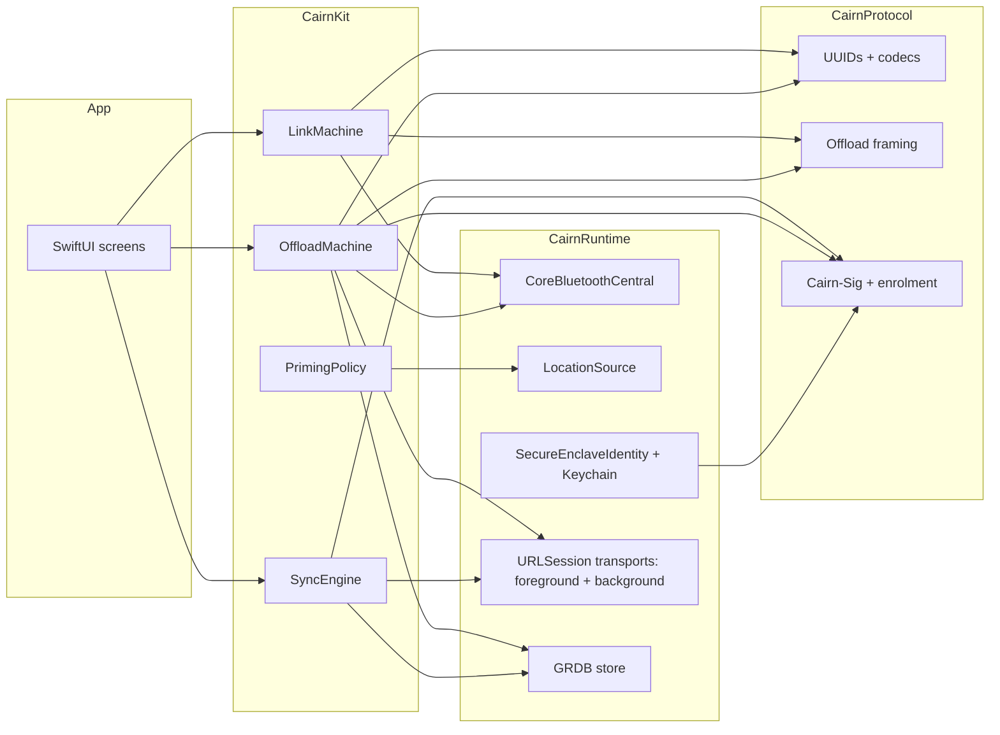

# iPhone app rewrite plan

**Status: Designed.** Nothing of the new app is built. This document is the design and the
reasoning; the schedule is [ROADMAP.md, Phase 37](../ROADMAP.md#phase-37--the-phone-rewritten--designed),
with sub-phases R0–R6. The app lives in
[cairn-ios-companion-app](https://github.com/ParkWardRR/cairn-ios-companion-app).

Added 2026-11-04 at the owner's request: *a totally new app; sunset the old one. BLE pairing
never works and neither does GPS quick start. Start small with the core, then build out the
front end: pairing, then GPS priming, then server connectivity, then more.*

**Contents:**
[1. What the audit found](#1-what-the-audit-found) ·
[2. Decisions](#2-decisions) ·
[3. What is kept](#3-what-is-kept) ·
[4. Architecture](#4-architecture) ·
[5. The phases](#5-the-phases) ·
[6. Cross-repository rows](#6-cross-repository-rows) ·
[7. Verification](#7-verification) ·
[8. Risks](#8-risks)

---

## 1. What the audit found

Four read-only audits on 2026-11-04 covered the iOS app, the firmware's BLE stack, the server's
app API and the contracts. The old app has 21,000 lines and 333 tests; none of the tests touch
the layer that fails.

**Pairing never completes, and it is mostly the app.**

- The app, its guide screen and its README assume a static 6-digit passkey. The shipping
  firmware pairs **Just Works** (bond + Secure Connections, no MITM, `NO_INPUT_OUTPUT`) and has
  flipped its AUTHEN flags across reflashes. Each flip leaves the iPhone holding a key the
  dongle no longer has, and the app cannot delete an iOS bond.
- A pairing failure reaches the app as a plain disconnect. Its failure counter increments on
  only one path, so it retries forever at 1 s with no feedback.
- Its "stale pairing" state is terminal: it clears the connection wish but leaves the session
  armed, so the Start control does nothing afterwards.
- The peripheral identifier is saved before bonding succeeds; from then on the app only ever
  connects to it, with no timeout and no fallback to scanning.
- Subscription errors are never observed, the MTU check is fatal rather than retried, and the
  auto-reconnect option is never set.
- Firmware [#44](https://github.com/ParkWardRR/cairn-esp32-device-firmware/issues/44) has been
  waiting since 2026-10-10 for a second central to settle whether the Mac's `bluetoothd` or the
  dongle is at fault. The iPhone is that central.

**Bundle offload cannot work.** The characteristic discovery list omits `0030` and `0031`, so
the offload capability is never detected and the controller exits before its first `LIST`.

**"GPS quick start" was never built end to end.**

- The phone streams 28-byte fixes and a wall clock. The dongle stores the fixes as a second
  position source (`source_flags` bit 5) and the clock as a `TIME_OBSERVATION`. Neither is
  handed to the u-blox receiver as a hint by the released firmware.
- Firmware `main` since 2026-10-26 (`85158b3`) does turn the phone's clock into
  `UBX-MGA-INI-TIME_UTC`, but the position hint comes only from Wi-Fi anchors or the last saved
  fix. The phone's fix is a better source and is one small addition to `src/gnss_hint.cpp`.
- The receiver sits behind the Freematics co-processor, which returns no UBX replies, so a hint
  cannot be acknowledged. The measure is the time-to-first-fix line the firmware logs per
  receiver start.
- The app's background location session is created only when `OBD_LIVE` or `DEVICE_STATUS`
  notifications arrive, and the firmware exposes neither. Streaming most likely stops when the
  phone locks. The live store holds zero phone positions.

**The server is ready.** QR enrolment, Secure Enclave request signing, one-hour bearer tokens
for background uploads, the four relay calls, signed receipts, and a sync log that publishes
trip summaries every 30 s, all tested. It has no passkey code by design: passkeys and Tailnet
identity are the dashboard's sign-ins, the app's credential is its signing key, and Tailnet is a
route. What it lacks for a phone is a trip track endpoint; tracks today come only in the
Parquet snapshot, which is why the old app carries DuckDB.

**Housekeeping.** The build number is hand-edited and already inconsistent (12 in `project.yml`,
13 in the pbxproj). Passkey UI was removed but its code remains. The README contradicts itself
on pairing.

## 2. Decisions

Taken on 2026-11-04 by the planning session; each is stated so the owner can overturn it
cheaply before R0.

| # | Decision | Why |
|---|---|---|
| D1 | **Same repository, same bundle id `app.cairn.companion`.** New source tree on `main`; the old tree is kept at tag `legacy-v1` and branch `legacy` | A new bundle id means a new App Store Connect record, a new CarPlay Driving Task entitlement request (Apple approved this one on 2026-10-08), a new AASA entry and new TestFlight testers. The identity is not what is broken |
| D2 | **The app is pairing-mode agnostic. Just Works stays** until firmware #5 restores MITM | The app triggers pairing by reading `PROTOCOL_VERSION` and lets iOS show whatever dialog the firmware's IO capability demands. A phone that works with both needs no change on the day the firmware changes |
| D3 | **GPS quick start = phone time and phone position sent as receiver hints**, measured by TTFF. No AssistNow through the phone | Thingstream ZTP is blocked (no chip id through the co-processor). Position and time hints are what the firmware already sends from weaker sources |
| D4 | **DuckDB leaves the phone.** The server grows a track endpoint; trips come from the sync log | A heavy binary dependency to read one Parquet table on a phone. The server already has the trusted-position view |
| D5 | **Four targets:** `CairnProtocol` (codecs and vectors, no I/O), `CairnKit` (state machines, pure), `CairnRuntime` (Apple frameworks behind protocols), `App` | The failures were all in untestable glue. Pure state machines get the tests; adapters stay thin |
| D6 | **Diagnostics are the first UI.** A Dongle screen that shows link state, errors, timings and exports a log | #44 could not be settled from the Mac. The phone must be able to say what it saw |
| D7 | **Keep GRDB, drop every other dependency** | Durable offload state and the sync cursor need a database; nothing else does |
| D8 | **Contract changes go through this repository first, additive, tagged with the owner's go-ahead.** Two are known: `GNSS_FIX` byte 26 as `companion_flags`, and the track endpoint | The pin rule. The app already deviates from `ble/v1` on byte 26; the contract should say what both sides do |
| D9 (**owner**) | Whether the in-app dashboard web view returns in R5, signing in with a passkey on the LAN origin and Tailnet identity on the ts.net origin | The host is not reachable by Apple's CDN, so passkeys in a dev build need `?mode=developer` and the associated-domains development switch |
| D10 (**owner**) | Minimum iOS 18.0, iPhone only, Swift 6 | Same as today. `CLLocationUpdate.liveUpdates` and `CBConnectPeripheralOptionEnableAutoReconnect` need iOS 17 or later |

## 3. What is kept

Ported file by file with their tests into `CairnProtocol` or `CairnKit`: `PayloadEncoder`,
`PayloadDecoder`, `EnrichmentPayloads`, `DeviceInfo`, the `BLE/Offload/*` codec, session and
transfer, `BundleOffloader`, `BundleRelayService`, `SigningString`, `CanonicalJSON`,
`EnrolmentProof`, `ConfigureLink`, `CairnServerClient` with `HTTPTransport`,
`SecureEnclaveIdentity`, `PinnedCA` (with the SPKI pin enforced this time), `HUDBuilder`,
`LinkHealth`, `TripSummary`, `FuelEstimate`, `DisplayUnits`, `DriveLog`, and the
contracts-fetch plus vector-replay test setup. Everything else is rewritten or deleted.

## 4. Architecture

Rules that follow from the audit:

- `CairnRuntime` adapters expose protocols (`Central`, `LocationSource`, `Clock`, `Transport`);
  `CairnKit` tests run against fakes. The link machine is a value type driven by events; every
  CoreBluetooth delegate call becomes one event with its error code preserved.
- One `AppModel` (`@MainActor @Observable`) owns the machines. No two objects write the same
  state.
- Every machine emits a `LinkLog` entry on each transition. The log is a ring buffer on disk,
  exportable from the Dongle screen.
- Characteristics are discovered with a `nil` filter and features are gated on presence plus
  the `PROTOCOL_VERSION` capability bits, so a firmware that adds `OBD_LIVE` needs no app change.

## 5. The phases

Each phase closes on hardware with a number written down. **Built** means it compiles and
passes its tests; **Proven** means the dongle and the phone did it and the bench record says so.

### R0 — Sunset and scaffold

1. In a worktree: tag `legacy-v1`, branch `legacy`, push both. On `main` delete
   `CairnCompanion/Sources`, `Tests`, `UITests`, the old `docs/*`, `HANDOFF-FIRMWARE.md` and
   `ui-ux-overhaul.md`. Keep `project.yml`, `Config/*.xcconfig`, the entitlements, `Info.plist`,
   `ExportOptions.plist`, `scripts/release-testflight.sh`, `scripts/fetch-contracts.sh`, the CI
   workflow and `contracts.lock`. Rewrite `README.md` to one page.
2. New `Package.swift` with the four targets. Port the keep-list with its vector tests; CI stays
   green at the end of this step.
3. Pin `contracts-v0.9.0` (BLE and sync bytes are identical to v0.8.0).
4. Build number from `git rev-list --count HEAD` in the release script, never by hand. Remove
   the hard-coded `CFBundleShortVersionString`.
5. Two screens: Dongle (empty) and Settings (build identity, channel, export log).
   `release-testflight.sh --export-only` passes.

**Closes when:** CI is green on the Mac runner, a TestFlight export succeeds, `legacy` is pushed.

### R1 — A BLE link that pairs every time

Nothing in the firmware changes first. The iPhone is the second central #44 has been waiting
for.

**`LinkMachine`** states: `off`, `idle`, `scanning`, `connecting(peripheral, deadline)`,
`discovering`, `securing` (the `PROTOCOL_VERSION` read is in flight; this is where iOS pairs),
`ready(capabilities, mtu)`, `backoff(attempt, reason)`, `needsForget(reason)`.

- Scan by service UUID; connect with a **15 s deadline**, then back to scanning. The identifier
  is persisted only on the first `ready`; a persisted identifier that fails twice falls back to
  a scan.
- Discover all characteristics. Required: `0001` and `00F0`; everything else optional.
- In `securing`: ATT `insufficientAuthentication` or `insufficientEncryption` means the user
  declined or iOS has no key: retry once, then `needsForget` with the exact code. A disconnect
  inside `securing` within 60 s of a connect counts as a pairing failure (that is how the
  dongle's own "pairing failed, disconnecting" arrives). Three in a row produce `needsForget`
  with the instruction to forget the device in Settings. `needsForget` is never terminal: Retry
  restarts from `scanning`.
- `didUpdateNotificationStateFor` errors are events and are surfaced.
- MTU below 28 after `ready` triggers a re-read of `00F0` after 500 ms, three times, before it
  is an error.
- `CBConnectPeripheralOptionEnableAutoReconnect` on every connect; state restoration takes a
  restored peripheral that is already connected straight to `discovering`.

**Dongle screen:** state, RSSI, MTU, firmware version from `DEVICE_INFO`, capability bits, last
error with its numeric code, time in state, Retry, Forget, Export Log.

**Bench matrix,** dongle on USB serial beside the phone, recorded as
`docs/bench/ble-pairing-YYYY-MM-DD.md` in the iOS repository:

| Case | Setup | Expect |
|---|---|---|
| Fresh pair | dongle `CLEAR bonds` via the prov console; phone has no bond | ready in under 10 s, no dialog |
| Dongle reboot | power-cycle the dongle while ready | ready again in under 5 s, no dialog |
| App killed | swipe the app away; the dongle re-advertises | relaunched by iOS, ready in under 10 s |
| Phone stale | phone forgets the device, dongle keeps its bond | the firmware drops its bond on PINKEY_MISSING; ready after one retry |
| Dongle stale | dongle `CLEAR bonds`, phone keeps its bond | `needsForget` within 3 attempts, message names the fix |
| Wi-Fi slot | dongle drops BLE for a Wi-Fi slot | `backoff`, then ready when advertising returns, no user action |
| Locked phone | lock the phone while ready; reboot the dongle | ready again with the screen off |
| Weak link | dongle 10 m away behind a wall | discovery fails, `backoff` with RSSI shown, never `needsForget` |

**Closes when:** every row passes twice, and #44 is closed (the phone pairs, so the Mac was at
fault) or retitled with the phone's log attached.

### R2 — GPS priming, and streaming that survives a locked phone

**App:**

- At `ready`: write `UTC_SYNC` at once and every 60 s. Write one `GNSS_FIX` from the cached
  last location even if it is minutes old, flagged `HINT` (`companion_flags` bit 1) so the
  firmware's 3 s staleness rule does not discard it. Then stream live fixes at 1 Hz, dropping to
  0.2 Hz once `GNSS_QUALITY` reports a 3D fix.
- `CLBackgroundActivitySession` is created at `ready` and ended at disconnect. Nothing is gated
  on characteristics the firmware does not expose.
- `PrimingPolicy` (pure, tested): what to send when, from link state, last-location age and
  receiver quality.
- The Dongle screen gains a receiver timeline: link ready → time hint → position hint → first
  2D → first 3D, in seconds since link-ready, from `GNSS_QUALITY`. The phone logs the same line
  so it can be set beside the firmware's TTFF line.

**Firmware** (one PR, host-tested, flashed over USB):

- `gnss_hint`: a phone fix arriving before the receiver's first accepted fix becomes
  `UBX-MGA-INI-POS_LLH` with accuracy `max(300 m, h_acc)`, at most once per receiver start,
  ahead of the Wi-Fi hint. The time hint already takes the phone's clock.
- A `GNSS_FIX` carrying `HINT` is accepted regardless of `sample_age_ms` for hinting only and is
  never recorded as a position sample.
- The saved-fix age bug in `sensors.cpp` (`millis()` compared across boots) is fixed in passing.

**Contracts** (one PR, additive): `ble/v1/spec.md` byte 26 of `GNSS_FIX` becomes
`companion_flags` (bit 0 charging, bit 1 hint), byte 27 stays reserved, with a vector for the
hint case. Tagged with the owner's go-ahead; the app pins it after.

**Closes when:** a drive with the app armed produces a trip whose store holds phone positions,
the firmware's TTFF line for that start says the phone hint went, and the Dongle screen's
timeline agrees. TTFF for three starts with and three without the phone goes in the bench record,
whatever it shows.

### R3 — Server connectivity: enrol, relay, receipt back

- **Enrolment screen:** scan or paste the `cairn://configure` link; show server, Tailnet URL and
  CA fingerprint; enrol with the Secure Enclave key; store client id, role, `instance_id` and
  `spki_sha256`. The SPKI pin is enforced on the LAN URL; the Tailnet URL validates normally
  (`sync/v1` §9). `NSAllowsArbitraryLoads` goes away: the pinned CA is a trust anchor in the
  delegate, which ATS permits.
- **Routing:** probe LAN `/v1/health`, then Tailnet; accept a route only if `instance_id` matches
  the enrolled one; cache the winner for 10 minutes.
- **`OffloadMachine`** (pure) with a GRDB row per bundle:
  `listed → manifest → offered → chunking(n of m) → committed → receiptHeld → delivered`. The
  receipt bytes are written to the row before `PUT_RECEIPT` is attempted; a phone that dies
  between commit and delivery resumes at delivery. `LIST` loops until no state-0 entries remain,
  because the dongle lists at most 16.
- **Errors by name:** `TRIP_ACTIVE` waits for the drive to end without alarm; `BUSY` retries in
  2 s; `429 too_many_offers` commits outstanding bundles first; `507 quota_exceeded`,
  `403 scope`, `403 assignment_refused`, `403 no_storage_key` and `422 quarantined` stop and are
  shown; receipt outcome 2 or 3 stops with "the server key does not match the dongle's" and is
  never retried blindly.
- **Background upload:** chunks go through a background `URLSession` with a bearer token from
  `/v1/auth/token`, refreshed on 401. Reads from the dongle stay in the foreground session that
  CoreBluetooth keeps alive.
- **Trigger:** offload whenever `ready` and no trip is active. The dongle holds standby while a
  phone is working, capped at 15 minutes per connection; the machine abandons politely at 14.
- **Dongle screen:** "N trips waiting on the dongle / uploading 2 of 5 / all synced", last
  receipt time, and the stop reasons in plain words.

**Closes when:** Phase 29's condition holds with no Mac involved, and engine-off to
receipt-delivered is recorded for three drives.

### R4 — Trips: the first real front end

- **Sync engine** against `sync/v1`: pull with cursor, apply `trip_summary`, `vehicle` and
  `assignment` entities and tombstones, ack; push `trip_annotation` and `odometer_correction`.
  The exchange vectors in `contracts/sync/v1/vectors/exchanges.json` are the test; passing them
  is what lets the spec leave draft (iOS #18, #31).
- **Trips list** grouped by day from `trip_summary`, and a detail screen with the stat bar and
  insight groups the old app had. Trips reconcile by overlapping time span, not by id.
- **Server:** `GET /v1/trips/{id}/track` (signed or bearer) returns a compact polyline plus gap
  markers from `v_position_trusted`, phone fixes excluded. Added to `sync/v1` as an additive
  endpoint.
- **Route map** on the detail screen from that endpoint; offline shows the cached summary and
  "last synced" instead of blocking.

**Closes when:** a trip is on the phone within 60 s of its receipt, with a route, after the app
was offline during the upload.

### R5 — Garage, CarPlay, dashboard, multiple dongles

In whatever order is useful once R1–R4 are Proven: Garage and vehicle profile from the old
models; `DEVICE_INFO` shown; the CarPlay HUD from `HUDBuilder`, **seen running in the car**; the
in-app dashboard per D9; multiple dongles and phones (iOS #26, #19); Wi-Fi/LTE provisioning over
BLE (#28) once its contract and firmware exist; the share sheet (#22) and DriveMark (Phase 35).

### R6 — Hardening

Gated on firmware #5: the enrolled-challenge handshake at session start, the per-session write
counter, the dongle fingerprint checked against the server's assignment, and the shipping
pairing (MITM, DISPLAY_ONLY, AUTHEN) restored. The app side is iOS #9: one new `LinkMachine`
state for the challenge, nothing for the pairing mode because of D2.

## 6. Cross-repository rows

| Repo | Phase | Required |
|---|---|---|
| iOS | R0–R6 | everything above |
| firmware | R1 | nothing, unless the bench shows a peripheral defect; close or retitle #44 |
| firmware | R2 | phone fix as `MGA-INI-POS_LLH` hint; `HINT` flag accepted; saved-fix age fix |
| front door | R2 | `ble/v1` byte 26 `companion_flags` plus a vector; tag with go-ahead |
| front door | R4 | `sync/v1` track endpoint; tag with go-ahead |
| server | R4 | `GET /v1/trips/{id}/track` |

## 7. Verification

- `swift test` for `CairnProtocol` and `CairnKit` on the Mac runner, vectors from the pinned
  contracts; `FakeCentral` drives the link and offload machines through every bench row in CI
  before hardware sees it.
- Hardware runs are recorded in `docs/bench/` in the iOS repository with the date, firmware
  commit, app build number and the numbers each phase asks for. A row is Proven only with that
  file committed.
- iOS builds and tests run on the Mac; fucina cannot build this repository. Firmware host tests
  and the server test for R4 run on fucina.
- Every local checkout was behind origin on 2026-11-04. Each phase starts with a fetch and a
  worktree under `/tmp`, never a commit in a shared tree.

## 8. Risks

- **The bench may show the fault is the firmware after all.** R1's log is designed so that
  outcome is a retitled #44 with evidence.
- **Antenna placement may swamp the priming gain.** R2 records the comparison either way; the
  OBD extension cable is the known hardware fix.
- **No OTA.** Every firmware change in R2 needs the dongle on USB.
- **One dongle, no spare.** Bench runs stop at anything beyond clearing bonds.
- **External TestFlight review** of a rewritten app is a manual App Store Connect step; internal
  testing is not.
